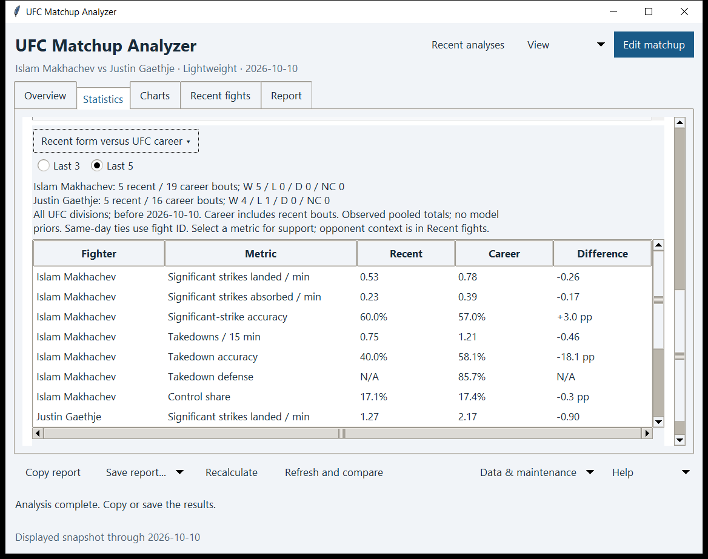
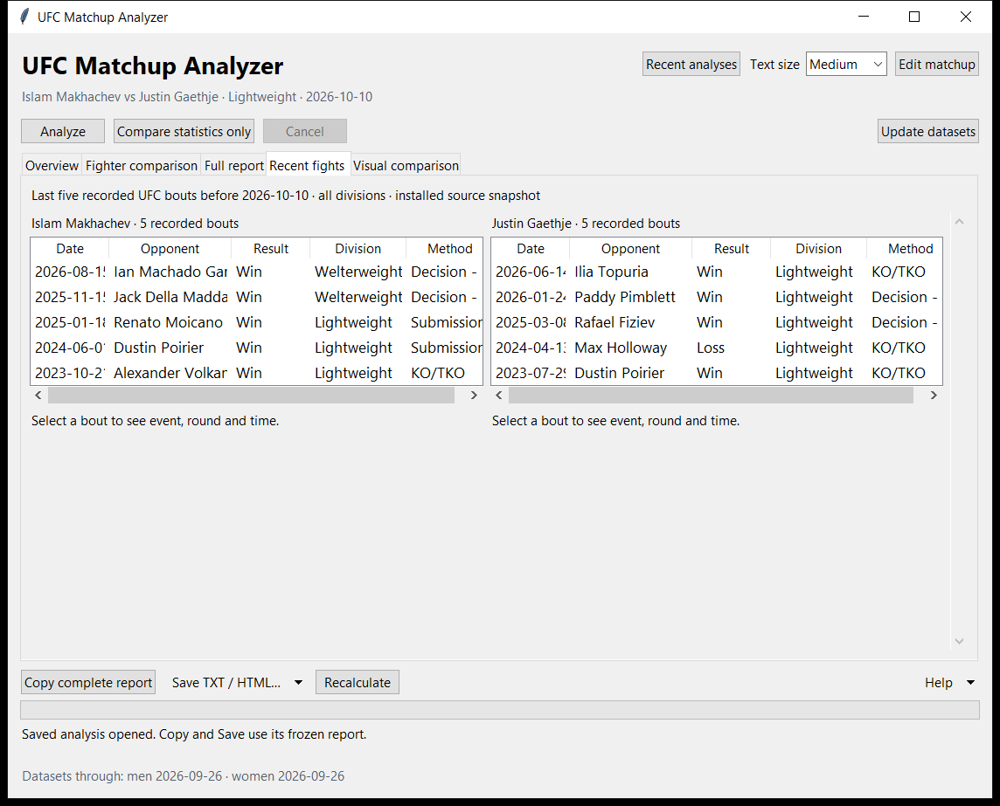
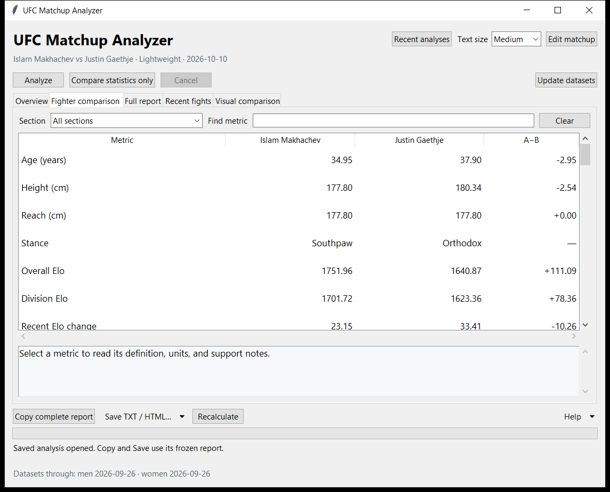
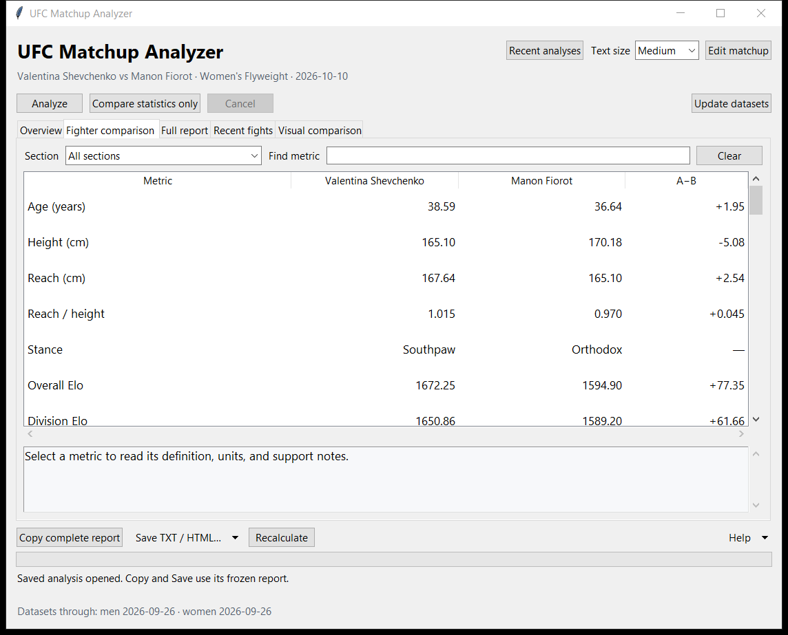
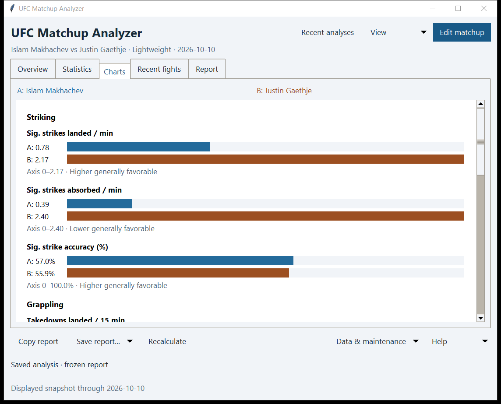

# UFC Matchup Analyzer

Version **0.8.0** is an experimental Windows portable prerelease. Download it from the [v0.8 release page](https://github.com/kry4ek/ufc-matchup-analyzer/releases/tag/v0.8.0). Release-specific verification is recorded separately from historical checks.

A small Windows app for analyzing one men's or women's UFC matchup. Enter the division, date and fighters, then get a detailed side-by-side comparison, win probabilities and data-quality information. Analysis runs locally using fight-history datasets.

Version **0.8.0** improves startup and dated-history preparation, adds expandable bout statistics and Last 3/Last 5 versus UFC career comparisons, guides saved-report refreshing and comparison, and exports compact printable HTML. The v0.7 model policies and datasets through 10 October 2026 are retained. See [upgrade notes](docs/V0_8_UPGRADE.md), [data contracts](docs/V0_8_DATA_CONTRACTS.md) and [the implementation plan](docs/V0_8_IMPLEMENTATION_PLAN.md).


Recent fights lists each fighter's last five recorded UFC bouts strictly before the selected fight date, across all divisions. It includes draws and no-contests, and keeps the same history in saved analyses and TXT/HTML exports. Older saved analyses remain readable and ask you to recalculate if their recent bouts were not saved.

Select a bout and choose **Show bout details**, Enter or double-click for available recorded fighter/opponent statistics and dated opponent Elo. **Statistics → Recent form versus UFC career** compares Last 3/Last 5 pooled observations with career totals and shows support for the selected metric. These descriptive rates do not add model priors. **Refresh and compare** captures a new report from installed data, retaining the original matchup date unless you explicitly choose today. **Save report → Compact summary** exports a smaller offline HTML layout for A4/Letter printing.





**Download v0.8:** use **ufc-matchup-analyzer-v0.8.0-windows.zip** from the [release page](https://github.com/kry4ek/ufc-matchup-analyzer/releases/tag/v0.8.0) for the app, runtime and all 15 matching datasets. The older [v0.6 release](https://github.com/kry4ek/ufc-matchup-analyzer/releases/tag/v0.6.0) contains its previous model and snapshot. GitHub's automatic source downloads and a Git clone contain source code only. There is no separate dataset ZIP.

Dataset redistribution remains `review_required`. Clean Windows 10/11 and actual alternate display-scaling checks are deferred. This prerelease uses available-machine verification; it is not a stable release or legal clearance. See [dataset provenance](DATA_NOTICE.md) and [release verification](RELEASE_VERIFICATION.md). Release-commit CI and anonymous-download evidence are supplied with the release assets.

## Download and start the Windows app

1. Download **ufc-matchup-analyzer-v0.8.0-windows.zip** from the [v0.8 release page](https://github.com/kry4ek/ufc-matchup-analyzer/releases/tag/v0.8.0).
2. Right-click the ZIP and choose **Extract All**. Use a writable folder, such as Documents.
3. Open the extracted **UFC Matchup Analyzer** folder.
4. Double-click **UFC Matchup Analyzer.exe**.

The ZIP includes Python, all runtime libraries, the interface and all 15 required datasets. No separate installation, administrator access, terminal, Git, GPU, account or API key is needed. Predictions work without internet; dataset updates need internet. Keep the `app` and `runtime` folders beside the executable and move the complete folder when relocating it. The candidate targets **Windows 10/11 x64**, subject to the verification limitations above.

## Run from source

Source operation requires **64-bit Python 3.14.7**, the locked libraries in `requirements.lock`, a writable folder, and every data file listed in `dataset_manifest.json`. Extract the matching v0.8 portable ZIP, then copy the listed datasets from **UFC Matchup Analyzer/app/** into the corresponding paths in a fresh source checkout. The v0.8 data contents match v0.7; published v0.6 data differs. Copy only the data; the source checkout already contains its code. The project's MIT code license does not grant rights to third-party data.

```bat
setup.bat
.venv\Scripts\python.exe analyzer_gui.py
```

Setup creates one local environment and checks dependencies and data. See [CLI and manual setup](docs/CLI.md) for prediction, comparison, maintenance and macOS/Linux instructions. Dataset-free contributor checks are described in [contributing](CONTRIBUTING.md); these are source checks rather than complete model validation.

## Analyze a matchup

Choose a labelled men's or women's division. The correct model is selected automatically. The date defaults to today; enter **YYYY-MM-DD**, such as `2026-10-10`.

Type at least two characters: suggestions appear automatically. Use arrow keys and Enter, or click a fighter. Matching ignores capitalization and accents. Misspellings produce credible close matches for you to select; unrelated text produces no match. The app never substitutes someone silently. Duplicate names require choosing the correct identity. Women's identities that the existing engine cannot safely distinguish are rejected. **Swap** exchanges the two fighters. Men's and women's selections are remembered separately.

Use **Today**, the calendar, or type the date. The app shows eligible fight counts, the latest included fight, and selected-division experience before you start. A warning and confirmation allow hypothetical matchups with no eligible or selected-division history; this does not create additional data.

Click **Analyze** and allow a few minutes. Dated comparison statistics appear before prediction training finishes. The progress bar appears only while an operation runs and identifies actual preparation, cross-validation and fitting stages; **Cancel** appears during an operation and stops analysis when cancellation is permitted. The installation stage explains when cancellation is unavailable. **Compare statistics only** prepares the comparison without fitting prediction models. No probability, winner or model reliability is generated in this mode. One computation or dataset operation can run per app folder at a time.

**Overview** presents probabilities, coverage warnings and twelve key statistics. **Statistics** groups every available metric; choose a section, filter metric names, or select a row to read its definition and support notes. **Report** contains the complete text and model details. Filtering does not remove information from exports. Inputs collapse after completion; **Edit matchup** opens them again. Use **View** to choose Small, Medium or Large text; text size and window size are remembered. Overview presents labelled evidence fields and uses one outer scroll area. Inputs scroll when space is limited, keeping the form usable with larger text.

These examples are hypothetical matchups, not an event schedule:

| Field | Men's example | Women's example |
|---|---|---|
| Division | Men — Lightweight | Women — Flyweight |
| Fight date | 2026-10-10 | 2026-10-10 |
| Fighter A | Islam Makhachev | Valentina Shevchenko |
| Fighter B | Justin Gaethje | Manon Fiorot |

The included snapshot produces approximately **82.1% / 17.9%** for the men's example and **36.5% / 63.5%** for the women's example. Results can change after dataset or algorithm updates.







## Initial evidence and visual comparison

After validating the selected model's datasets, the app shows an initial comparison with profile measurements, eligible recorded bout counts and recent fights while advanced preparation continues. This view is explicitly partial and contains no probability. Draws and no-contests count as recorded bouts. Cancellation or failure preserves a labelled partial report for copying/export; it is not saved as a completed analysis.

Generated times use readable local dates with an explicit UTC offset; stored report timestamps are preserved.

The Overview evidence block records each fighter's eligible UFC and selected-division bout counts, latest bout, dataset date and evaluation compatibility. **Evidence details** explains cutoffs, available attempt support and methodology limits. Zero supporting attempts means a smoothed estimate is prior-only. Recorded bout counts do not substitute for attempt denominators. The same captured facts appear in clipboard, TXT and HTML exports; older reports keep their original evidence. A dataset update can differ from the dated evaluation snapshot without changing that report's original findings.

The **Charts** tab shows paired striking, grappling and activity metrics plus engine pre-bout Elo histories. Percentages share a 0–100% axis; other metrics share a zero-based axis per row. Missing values remain unavailable. Fight counts describe eligible history, while unavailable attempt denominators are stated explicitly. Men's trends use stored decisive-bout engine states; women's use prepared live histories. Division ratings in the evidence table refer to each bout's division. Fighter colors and named legends match Overview and Statistics. Elo axes use successive recorded bouts for each fighter, rather than a shared calendar timeline. Focus the Elo chart and use Left/Right to inspect points, or read its selectable numeric evidence. The charts, numeric evidence and offline HTML/TXT exports use the same frozen evidence. Older saved reports do not acquire current-source Elo histories.

**Help → Model validation** opens the dated research report offline. It includes chronological holdout results, calibration counts, baseline comparisons and the internal-fold audit. A small historical evaluation and a failed methodology audit do not establish general accuracy or profitability. Installed-data/engine changes are reported against the evaluated snapshot.

## Upgrade from another portable folder

Extract the new portable app into a separate writable folder. Choose **Data & maintenance → Import from previous installation…**, select the previous extracted app folder, and review the eligible/skipped records. Ctrl+click to choose a subset that fits the remaining capacity. Close the older app before applying the capture. Existing destination records remain; duplicates, conflicting IDs, invalid records and entries exceeding the 50-entry/50-MB budget are reported. Original source files remain unchanged.

An optional checkbox imports text/window/collapsed-input preferences and remembered selections validated against the current fighter catalog. Obsolete or ambiguous fighter names are cleared. Current history-storage preferences remain in place. Datasets, executable files, caches, transaction state and machine-specific export paths are excluded. Imported analyses retain their original results and timestamps; compatibility determines whether they can be reused. **Data & maintenance → Undo latest import…** reverses unchanged imported files/preferences, while retaining and reporting subsequent changes. Interrupted imports recover at the next launch.

## Copy and save

**Copy report** copies the entire displayed analysis. Select text in Report and press Ctrl+C to copy a portion. **Save report…** lets you choose a text or HTML report, then opens a standard Save dialog with `Fighter A vs Fighter B.txt` or `.html` prefilled. HTML includes formatted tables and complete model notes, opens offline, and can be printed from a browser. Exports use UTF-8, including accented names. Statistics-only exports have a clearly labelled filename.

Changing input fields does not alter an existing result; a banner identifies a previous matchup. Copy and Save refer to the displayed report, including clearly labelled pending, failed or cancelled comparisons. Keyboard: **Ctrl+Enter** analyzes; **Ctrl+Shift+C** copies the report; **Ctrl+S** saves; **Ctrl+F** finds a metric; **Ctrl+Plus/Minus** changes text size; Tab moves between controls.

## Recent analyses and faster repeat requests

**Recent analyses** keeps up to 50 completed predictions/statistics comparisons, capped at 50 MB, inside the app folder. Open or delete entries, or clear all history. A matching valid request automatically reopens its result with the original generation time and a reuse label. **Recalculate** bypasses saved-result reuse and calculation-cache reads. The key includes fighter identities/order, division, dates/cutoff, calculation settings, dataset contents, implementation and runtime versions. Reversed matchups are computed separately.

Different matchups can also reuse compatible prepared history and fitted models. This calculation cache is content-checked and capped at 1 GiB; it is separate from saved analyses. **Recalculate** bypasses both kinds of reuse. **Data & maintenance → Clear calculation cache** shows its size and clears prepared work while retaining datasets and saved reports. The first calculation for a new dataset/date/configuration still performs preparation and training.

In **Recent analyses**, Ctrl+click two entries and choose **Compare versions**. The view aligns fighter order by stable identities, shows probability changes in percentage points, compatible metric changes, and differences in calculation context. Full eligible-fight evidence identifies additions or changed records without mistaking a bout leaving the last-five panel for a deletion. Older analyses can be opened; unavailable comparison evidence is explained. Comparisons and their TXT/HTML exports work offline.

Dataset changes or a new app version can make saved results outdated. They remain viewable, but cannot be reused for a current computation. A restored dataset can make an otherwise matching result valid again. Disable **View → Keep recent analyses and reuse valid results** to stop new storage and reuse; existing entries remain until you clear them. Cancelled jobs and failed predictions are not saved as completed analyses. You can read and export older results while another operation runs; **Open new result** appears when the new analysis is ready.

## Update datasets

Choose **Data & maintenance → Update datasets** while connected to the internet. One click updates both models: download into staging → audit completed fights → rebuild changed features → validate → install successful changes. The app reports added-fight counts and freshness dates. With no changes it reports **Already up to date**.

Use **Data & maintenance → Recheck recent events** to look for source corrections to already recorded bouts. Choose an inclusive range (default: last 90 days, maximum 20 completed events), review the captured field-level changes, then choose **Apply captured corrections**. Apply installs the reviewed capture after revalidating the installed-data fingerprints; it does not silently fetch a different version. Known bouts missing from a response or conflicting fighter identities block replacement. A win overturned to a draw/no-contest retains its statistics and removes its binary training rows. Use the existing Restore action to undo an applied correction.

Failures preserve your installed datasets. Do not move or delete the app folder during an operation. Updates can be cancelled before installation starts; the commit finishes or recovers safely. Interrupted transactions are checked at the next launch before analysis is enabled.

**Data & maintenance → Restore previous datasets** undoes the latest successful update or rebuild after confirmation. The app retains its latest recoverable backup and bounds older logs. **Data & maintenance → Rebuild local features** uses local inputs without downloading fight data. **Data & maintenance → Check installation** checks components, hashes and readiness. **Data & maintenance → Open diagnostics** opens the relevant log.

Updating fight data rebuilds features. Predictions train the selected algorithm locally for the requested date. Algorithm changes arrive through a new app release. See [maintenance](docs/MAINTENANCE.md).

## Understand the results

The report compares **A** and **B** in aligned tables: physical attributes, overall/division **Elo**, opponent strength, UFC experience, striking, grappling, recent form, activity and available win/loss methods. Men's advanced comparison also includes refined opponent ratings, round experience, layoffs and division movement; women's includes opponent-Elo-weighted performance. Bayesian rate estimates and attempt counts explain how sparse histories are smoothed. Model details show men's raw/calibrated estimates or women's component probabilities, ensemble weights, disagreement and reliability factors.

The **Matchup summary** above Overview's metrics highlights up to three supported observations and two data limitations. **View supporting metrics** filters the comparison to the cited evidence. Summary rules describe recorded statistics; they do not infer feature importance or explain why the model produced its probability. Saved results and exports retain the exact summary originally generated. Earlier saved reports identify a missing summary instead of regenerating one from current data.

[Current Overview and supporting comparison](docs/images/ui-polish-overview.png)

**A − B** is the numerical difference, not a verdict on who is better. Percentage differences use **percentage points (pp)**. **N/A** means unavailable; zero remains zero. Elo is an internal calculated rating starting at 1500, not an official ranking. Read the explanations beneath the comparison for metric definitions and differing history windows.

Scroll down to see the complete report. Tables keep their columns aligned when you resize the window; use the horizontal scrollbar for wider sections. Copy and Save include **every section**, even those currently outside the visible area. Open saved TXT files in a monospace font for aligned columns.

Probabilities are estimates, not guaranteed outcomes. Men's confidence follows its retained model policy. Women's legacy reliability thresholds have not been validated for the corrected policy, so the app shows **Not validated for this policy** without an inherited numerical grade. Component agreement, attempt support and missing-history warnings remain diagnostic information.

Historical fight statistics exclude the selected fight date and later fights; physical measurements may reflect newer profile corrections. Future matchups use eligible data available in the installed snapshot. The included snapshot reaches **2026-10-10**; the footer shows current dates after updates. Models cannot capture every injury, camp change or unrecorded circumstance. See [model notes](docs/MODELS.md) for methodology and leakage checks.

Typical observed analysis times are about **1–4 minutes** on the test computer. If the displayed analysis already contains statistics for the same fighters, order, division and date, **Compare statistics only** opens its Statistics tab immediately. The prediction, timestamp, Copy and Save remain attached to that existing report; no datasets are reloaded and no extra history entry is created. Use **Recalculate** to request fresh computation. Changed matchups or results marked outdated follow the normal preparation workflow.

Fresh statistics-only comparisons still prepare advanced features: men's preparation can take about as long as a full prediction, while women's comparison avoids the longer cross-validation stage. Matching saved results loaded for a new calculation avoid preparation and training but still verify dataset contents. The portable package simplifies installation. Measured package sizes, memory, timings and limitations are in [release verification](RELEASE_VERIFICATION.md). Keep at least **1 GB free** for staging and backups; maintenance checks space before proceeding.

See [troubleshooting](docs/TROUBLESHOOTING.md), [CLI/manual source setup](docs/CLI.md), [contributing](CONTRIBUTING.md), and [portable build instructions](docs/BUILDING.md). macOS/Linux source operation is not presented as verified portable support.

Project code is MIT licensed. [Dataset rights](DATA_NOTICE.md) and [third-party licenses](THIRD_PARTY.md) are separate. This independent project is not endorsed by UFC or UFCStats.
