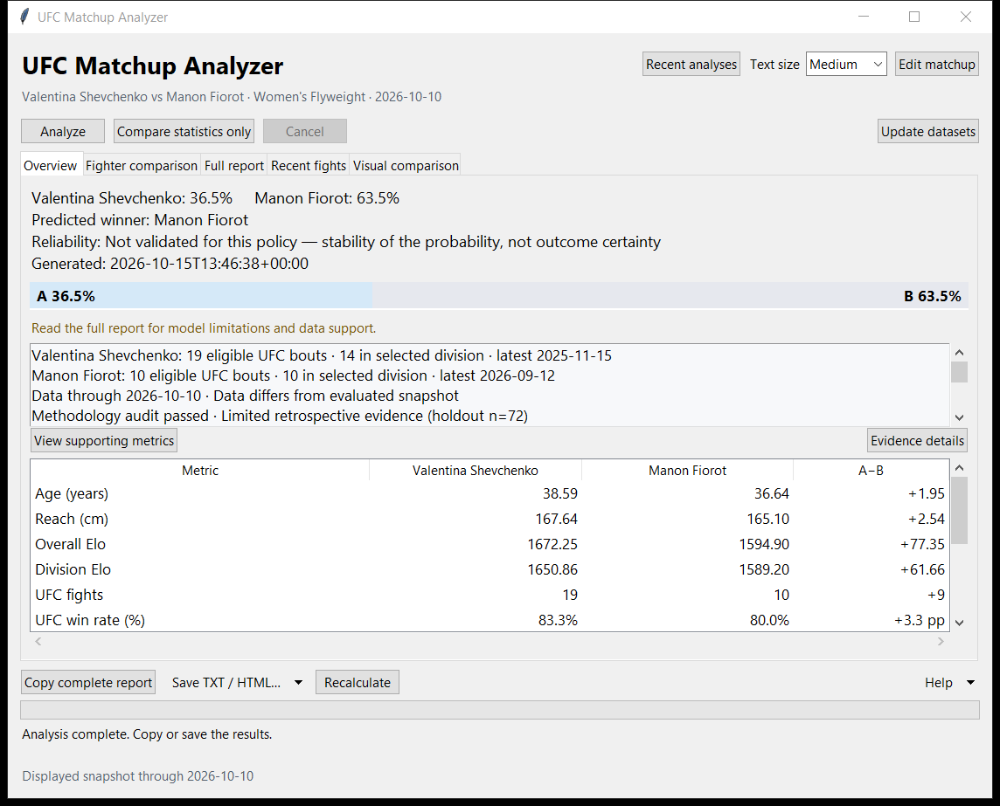
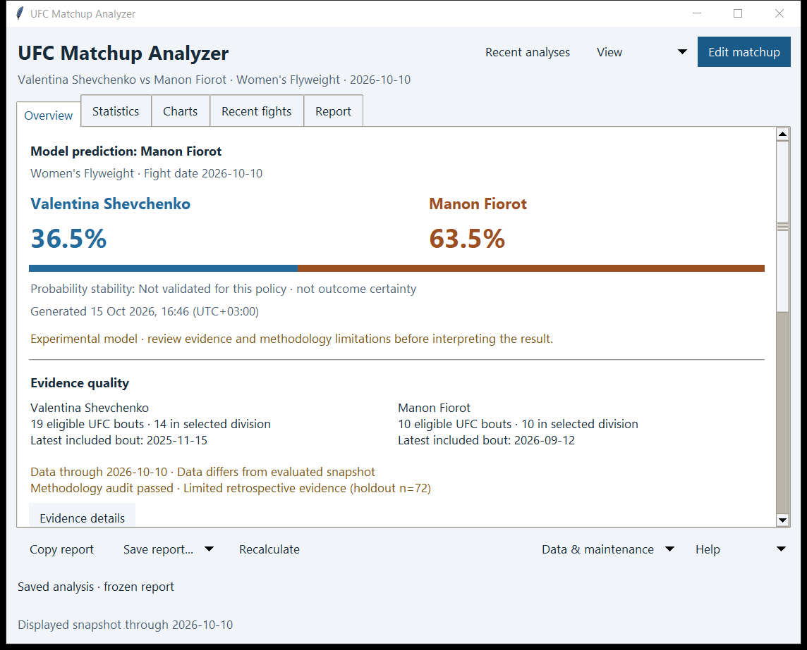
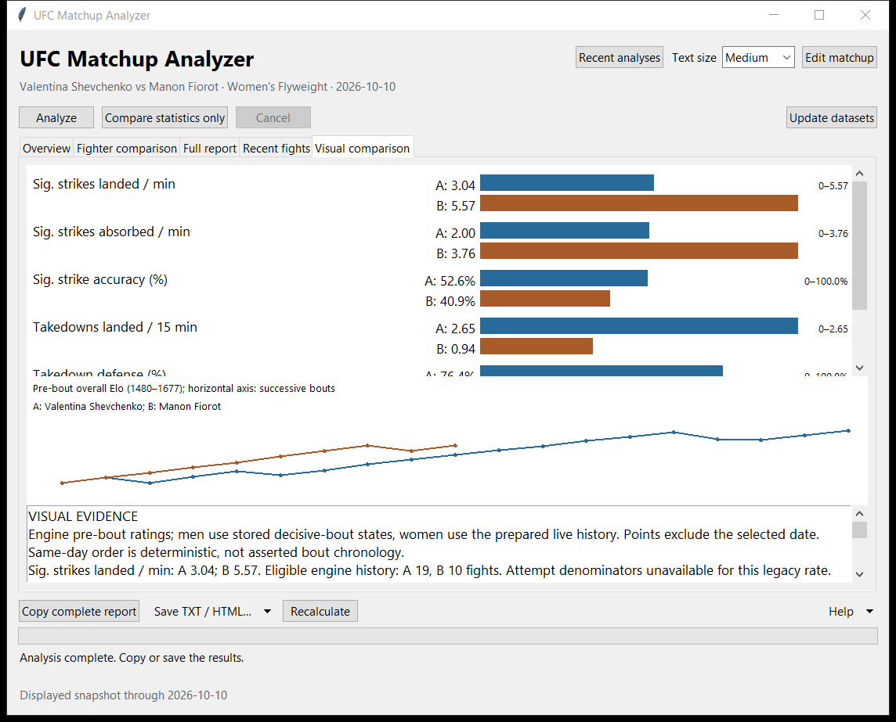
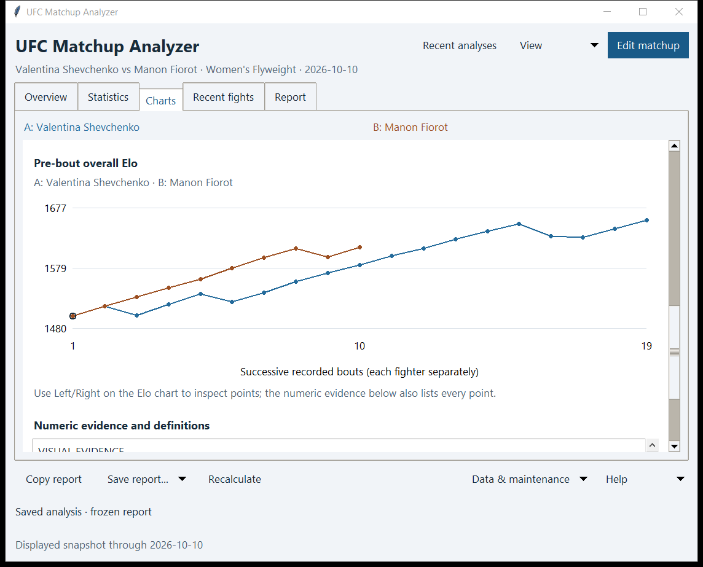
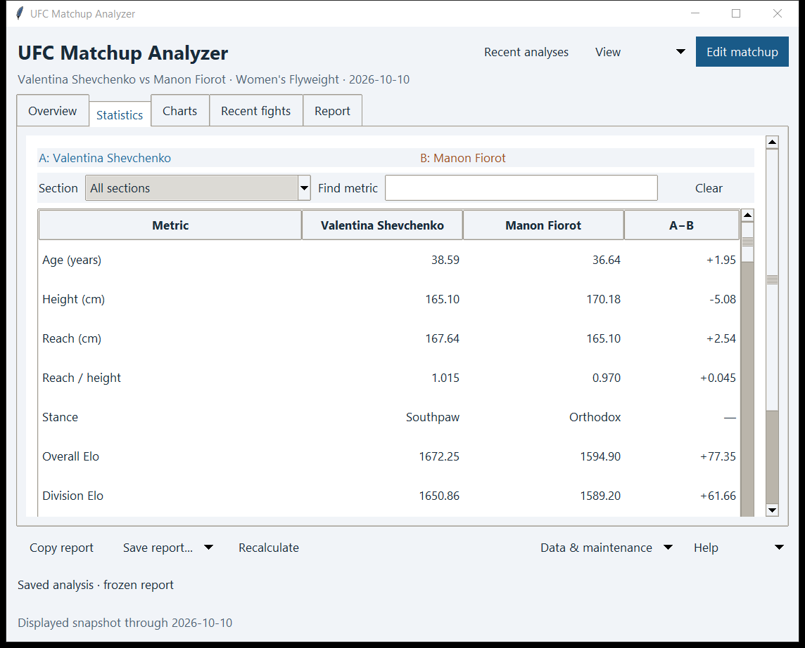

# UI polish verification — 15 October 2026

All six UI improvements are implemented locally in the v0.7 application. This report covers presentation and interaction checks; existing model, dataset, and release limitations still apply.

## Delivered changes

| Improvement | Implementation |
| --- | --- |
| Prominent matchup result | Full fighter names, large probabilities outside the colored bar, model prediction, dated context, recorded reliability and readable generation time. Partial/cancelled/failed/statistics-only views clear probability and reliability fields. |
| Structured Overview | Prediction, labelled frozen evidence and twelve key statistics; observations retain supporting-metric navigation. Missing legacy evidence remains explicitly unavailable. |
| Simpler controls | Primary Analyze/Edit matchup styling, grouped Copy/Save, View preferences, a dedicated Data & maintenance menu, and stable command/tab references. Cancel follows actual controller availability. |
| Readable charts | Shared named fighter legends, grouped paired metrics, zero-based axes, explicit direction, unavailable values, labelled Elo axes/gridlines and single-point markers. Left/Right and the selectable numeric evidence provide point inspection. HTML uses matching colors and labels. |
| Consistent visual style | Shared Segoe UI typography, spacing, light surfaces, blue/orange fighter colors, button/table/tab styles and visible focus indicators. Dialogs use the same text preference. |
| Everyday interaction polish | Overview / Statistics / Charts / Recent fights / Report navigation; local generated times with explicit UTC offsets; operation-only progress; scrollable inputs/results when space is limited; preserved shortcuts and stale/saved/new-result notices. |

The active application uses a semantic command registry. The retained legacy base constructor still constructs its original temporary menu before the enhanced interface replaces it; its numeric positions do not control the new menus.

## Verification results

| Check | Result | Evidence |
| --- | --- | --- |
| Complete native regression suite | PASS — 211 tests | `work/ui-polish/final-tests.log` |
| Focused final presentation checks | PASS — 7 tests, including probability clearing, immutable evidence, missing values, timestamps, menu mapping and focus styling | `work/ui-polish/final-focus-tests.log` |
| Expanded native layout matrix | PASS — 48 states across 100/125/150/200% simulated Tk scaling, Small/Medium/Large text, two requested window sizes and expanded/collapsed inputs | `work/ui-polish/final-review/verification.json` |
| Existing scaling/focus harness | PASS at 100/125/150/200% simulations before the final focus-border refinement | `work/ui-polish/layout.json` |
| Setup checks | PASS — 8 checks; installation branches mocked | `work/ui-polish/setup-tests.log` |
| Source/dependency/data audit | PASS; repeated after final documentation and packaging | `work/ui-polish/audit.json` |

Layout checks respect the application's supported minimum window dimensions and record both requested and actual sizes. The requested sizes are 1366×768 and 960×700; larger simulated scales can raise the actual minimum size. This does not establish usability at arbitrary dimensions below that minimum.

The layout matrix checks all five tabs, explicitly checks busy-only controls, verifies keyboard access to scrolled inputs and metric filtering, and reaches the bottom of longer Overview/Statistics sections. The Statistics view uses an outer viewport so enlarged text and open inputs cannot squeeze the table out of the layout. The long numeric chart evidence and metric table retain their own scrolling.

## Frozen-report checks

Review fixtures were extracted from two existing saved v0.7 analyses in the earlier local delivery folder. Copies under `work/ui-polish/fixtures/` are used only for review. Their contents remain equal before and after rendering, resizing, font changes and keyboard chart inspection. The verification JSON records their hashes.

The current screenshots show the saved 10 October matchup examples. The women's evidence retains its limited retrospective evaluation, holdout n=72, passed methodology audit, dataset/evaluation mismatch, and withheld reliability grade. Rendering does not replace these captured findings with a new evaluation. Earlier frozen reports and synthetic edge cases were also exercised during implementation.

Existing tests cover saved-result reuse, changed inputs, background-history viewing, initial evidence, pending/cancelled/failed comparisons, HTML/TXT escaping, import/undo, maintenance failures, cancellation and transactional recovery. Presentation changes did not require model retraining.

## Screenshots

Before and after use the same frozen women's result and the same requested 1100×850 window at the current native display scale.

| Before | After |
| --- | --- |
|  |  |
|  |  |

Additional screenshots of all five tabs for both model families, key statistics, Elo history, evidence details, history and maintenance are in `work/ui-polish/final-review/`.

## Portable candidate

A separate candidate is built at `dist/UFC Matchup Analyzer UI polish/`, reusing the manifest-verified v0.7 runtime and launcher. The packaging allowlist includes both new presentation modules. Candidate verification is recorded in `work/ui-polish/portable-build.json`, `portable-smoke.json`, `native-dependencies.json` and `package-verification.json`.

The native EXE smoke check passed: ready to analyze, Python 3.14.7, Tk 9.0.4, startup checks completed in 17.6 seconds on this computer. Static dependency closure passed for 299 native PE files with no missing imports. The package inventory and source parity checks passed; the report records the number of checked files.

This is a local candidate; the existing published release and prior local candidate folders are separate artifacts.

## Remaining verification limits

The current native display reports 120 DPI (125%). Alternative scales in this report are Tk simulations, not changes to Windows display settings. Actual Windows 100%, 150% and 200% checks and clean Windows 10/11 checks remain outstanding. The UI work does not resolve existing dataset rights, unsigned launcher, or general model-validation limitations.
